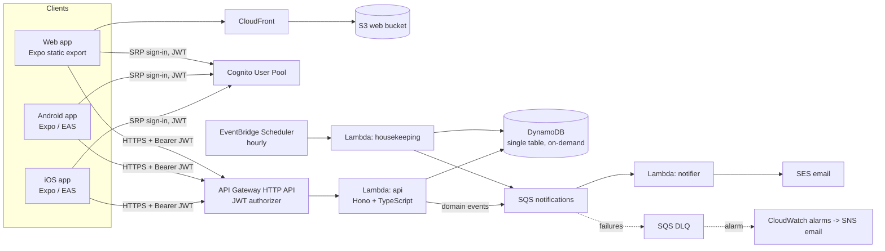

# BadmintonSmash — System Design

| | |
|---|---|
| Status | Draft v1 for review |
| Date | 2026-11-18 |
| Inputs | [01-product-spec.md](01-product-spec.md) |
| Outputs | [03-api-reference.md](03-api-reference.md), [04-deployment.md](04-deployment.md), [05-architecture-diagrams.md](05-architecture-diagrams.md), [06-auth-flows.md](06-auth-flows.md) |

## 1. Overview

One TypeScript monorepo. One Expo app that builds to iOS, Android and a static web bundle. One HTTP API running as a single AWS Lambda function behind API Gateway, authenticated by Cognito, storing everything in one DynamoDB table. Side effects (emails) go through an SQS queue to a second Lambda. Everything is defined in AWS CDK and deployed from GitHub Actions.



## 2. Decisions

Each row is the choice, why, and the nearest alternative that was not chosen.

| Area | Decision | Why | Alternative not chosen |
|---|---|---|---|
| Client | **Expo SDK 58 + Expo Router**, one codebase for iOS, Android and web | The spec demands full web parity plus store apps; Expo Router gives file-based routing and real URLs on web, so share links work everywhere. TypeScript end-to-end matches the backend. | Separate Next.js web + React Native app: two UIs to keep in sync. Flutter: fine, but no shared types with a TypeScript API. PWA only: no App Store presence. |
| Web hosting | **S3 + CloudFront** serving `expo export --platform web` | Static export, global CDN, pennies per month, SPA fallback to `index.html`. | Amplify Hosting: easy but another deploy pipeline outside CDK. Lambda SSR: not needed, the app is behind sign-in. |
| API front door | **API Gateway HTTP API** | Native JWT authorizer validates Cognito tokens without code, built-in CORS, about 70% cheaper per request than REST API, mature CDK L2. Per-client API keys, WAF and request validation (REST API only) are not needed; validation lives in the handler with zod. | Lambda Web Functions (Node HTTP server on Lambda, CloudFront in front): attractive, but auth would move into app code and CDK support is younger. Can be adopted later because the handler is a plain Hono app. |
| API compute | **One Lambda (Node.js 22, TypeScript, Hono router)**, on-demand | Traffic is tiny and bursty (evenings, before sessions). One function keeps cold starts to one warm path, deploys atomically, and is trivial to run locally. Managed Instances do not fit: traffic drops to zero most of the day. | One Lambda per route: more cold starts, more IAM, no benefit at this scale. ECS/Fargate: always-on cost. |
| Database | **DynamoDB, single table, on-demand** | $0 idle (always-free tier covers this app for years), atomic conditional writes and transactions give exact capacity enforcement, DynamoDB Local for tests, deep Lambda/CDK integration. Access patterns are few and fixed (section 5). | Aurora DSQL: Postgres syntax and also scale-to-zero, a good choice if reporting or ad-hoc queries grow. Revisit if the access-pattern table in section 5 stops fitting. Aurora PostgreSQL Serverless: minimum capacity cost is wrong for a hobby-scale app. |
| Auth | **Cognito User Pool**, passwordless **email one-time code** as the primary factor (password kept as secondary), plus **Google** as a federated IdP through the Cognito hosted domain; **WeChat** later through an OIDC shim (section 9.2) | The product owner's direction: Google plus email one-time code. One token issuer for the API whatever the login method; no passwords to forget or reset. Needs the Cognito ESSENTIALS feature plan. WeChat is not OIDC and needs a verified company account, so it is bridged rather than built in. | Email + password: more friction and a reset flow. Custom auth in Lambda: more code and risk. Auth0/Clerk: monthly cost and another vendor, and still no WeChat. |
| Localisation | **Message files in the client** (`en`, `zh-CN`), bilingual email templates | The audience is bilingual; emails serve mixed groups without per-user locale plumbing. | Server-driven strings: no benefit for a two-language app. |
| Notifications | **SQS → notifier Lambda → SES** | Decouples email latency and failures from the API; retries and a DLQ for free. Push later via the same queue. | Sending from the API handler: slows requests, no retry. EventBridge bus: good for many consumers, overkill for one. |
| Scheduled work | **EventBridge Scheduler (hourly) → housekeeping Lambda** | Auto-complete events 24 h after end, later reminders. Idempotent, cheap. | Per-event one-time schedules: elegant but more IAM and cleanup. Step Functions: nothing to orchestrate. |
| IaC | **AWS CDK v2 (TypeScript)** | Same language as the app; `NodejsFunction` bundles with esbuild; L2 constructs grant least-privilege IAM. | SAM: fine, YAML. Terraform: no need for multi-cloud. |
| CI/CD | **GitHub Actions** with OIDC role, `cdk deploy` on main; EAS Build for stores | Repo is on GitHub. No long-lived AWS keys. | CodePipeline: more setup for the same result. |
| Region | **us-west-2** (configurable) | Closest full-featured region to Mountain time; SES, Cognito, Scheduler all available. Switch to ca-central-1 if Canadian data residency matters. | — |
| Environments | `dev` and `prod` as stack prefixes in one account, optional second account for prod later | Cheap and simple now, clean upgrade path. | — |

## 3. Monorepo layout

```
BadmintonSmash/
├── shared/               zod schemas, DTO types, fee calculator, join rules. Used by api and client.
├── api/                  Hono app + Lambda entrypoints (http, notifier, housekeeping). Vitest against DynamoDB Local.
├── infra/                CDK app: Persistence, Backend, Web, Bootstrap stacks.
├── client/               Expo app (iOS, Android, web). Expo Router, TanStack Query, Amplify Auth.
├── docs/                 This spec, design, API reference, deployment runbook.
├── scripts/              pull-env.sh, deploy-web.sh
├── .github/workflows/    ci.yml, deploy.yml
├── package.json          npm workspaces, root scripts (typecheck, test, synth)
└── tsconfig.base.json
```

`shared` is the contract: every request and response schema is a zod schema there, inferred into TypeScript types, validated in the API and used for forms in the client. There is no separate OpenAPI generator in v1; [03-api-reference.md](03-api-reference.md) is written from those schemas.

## 4. Client (Expo)

**Routing (Expo Router, file based)**

```
app/
  _layout.tsx               providers: QueryClient, Auth session, theme
  (auth)/sign-in|sign-up|verify|reset.tsx
  (tabs)/_layout.tsx        Home | Explore | Money | Profile
  (tabs)/index.tsx          Home: Upcoming / Hosting / Past segments
  (tabs)/explore.tsx
  (tabs)/money.tsx
  (tabs)/profile.tsx
  events/new.tsx            create (also used by duplicate with prefilled params)
  e/[id].tsx                event detail, works signed-out (public redacted view)
  e/[id]/edit.tsx
  e/[id]/roster.tsx         host roster with attendance and payment status
  e/[id]/settle.tsx         settlement form
```

**Web URLs** are the share links: `https://<web-domain>/e/<eventId>`. Mobile deep links use the `badmintonsmash://` scheme; universal links are a P1 follow-up (host AASA and assetlinks files from the same bucket).

**Data layer**: a small typed API client (`fetch` + Bearer token from Amplify `fetchAuthSession`) and TanStack Query hooks per resource. Mutations invalidate the event and list queries. Lists are cached so the app opens offline with the last state.

**Auth**: `aws-amplify` v6 Auth category only, configured from env (`EXPO_PUBLIC_USER_POOL_ID`, `EXPO_PUBLIC_USER_POOL_CLIENT_ID`, `EXPO_PUBLIC_API_URL`). Tokens stored in secure storage on native, localStorage on web. The app sends the **access token**; the API identifies users by its `sub`.

**Responsive layout**: single column up to 720 px; on wider web screens the content column is centred at max 840 px and the tab bar becomes a left rail. No web-only or mobile-only screens.

**Date/time**: inputs use native pickers on mobile and `<input type="datetime-local">` on web through one wrapper component. Everything is sent as ISO 8601 UTC plus IANA time zone.

**Localisation**: `src/i18n/en.ts` and `src/i18n/zh-CN.ts` export the same typed message object; a `useT()` hook picks the language from a stored override or the device locale. No i18n framework is needed for two languages.

**WeChat in-app browser**: the static web build runs inside WeChat's webview. The sign-in screen detects `MicroMessenger` in the user agent, hides Google sign-in and shows "open in Safari/Chrome" guidance (ACC-8). Share-roster uses the clipboard on web and the native share sheet on mobile (SGN-11).

## 5. Data model (DynamoDB)

One table `smash-<env>` with on-demand capacity, point-in-time recovery, AWS-owned encryption.

| Attribute | Type | Purpose |
|---|---|---|
| `PK`, `SK` | S | Primary key |
| `GSI1PK`, `GSI1SK` | S | "Things owned by a user" index |
| `GSI2PK`, `GSI2SK` | S | "Events by status" index (explore, housekeeping) |
| `type` | S | `USER` / `EVENT` / `SIGNUP` |

### 5.1 Items

**User profile**

| Key | Value |
|---|---|
| PK / SK | `USER#<userId>` / `PROFILE` |
| Fields | `userId` (Cognito sub), `email`, `displayName`, `phone?`, `paymentHandles` {etransfer?, venmo?, zelle?, paypal?, other?}, `notificationPrefs`, `lastEventDefaults` {currency, shuttleUnitCostCents, timezone}, `createdAt`, `updatedAt` |

**Event**

| Key | Value |
|---|---|
| PK / SK | `EVENT#<eventId>` / `META` |
| GSI1PK / GSI1SK | `HOST#<hostId>` / `<startsAt>#<eventId>` |
| GSI2PK / GSI2SK | `STATUS#<status>` / `<visibility>#<startsAt>#<eventId>` |
| Fields | `eventId` (12-char URL-safe id), `hostId`, `hostDisplayName`, `title`, `description`, `venue` {name, address?, mapUrl?}, `startsAt`, `endsAt`, `timezone`, `capacity`, `courts?`, `visibility` (`link`/`public`), `status` (`draft`/`open`/`closed`/`completed`/`cancelled`), `signupOpensAt?`, `signupClosesAt?`, `cancelDeadlineHours?`, `fee` {mode: `fixed`/`settle_after`, currency, fixedAmountCents?, estimateCents?}, `settlement?` (section 7), `confirmedCount`, `waitlistCount`, `signupSeq`, `version`, `createdAt`, `updatedAt` |

**Signup**

| Key | Value |
|---|---|
| PK / SK | `EVENT#<eventId>` / `SIGNUP#<userId>` |
| GSI1PK / GSI1SK | `USER#<userId>` / `<startsAt>#<eventId>` |
| Fields | `eventId`, `userId`, `displayName` (denormalised), `status` (`confirmed`/`waitlisted`/`cancelled`/`removed`), `seq` (monotonic per event, waitlist order), `partySize` (1 in v1), `note?`, `lateCancel?`, `attended?` (default true), `amountOwedCents?`, `paymentStatus?` (`unpaid`/`paid`/`waived`), `claimedPaidAt?`, `paidAt?`, `joinedAt`, `updatedAt` |

### 5.2 Access patterns

| # | Need | Operation |
|---|---|---|
| 1 | Event by id | `GetItem EVENT#id / META` |
| 2 | Event + roster | `Query PK = EVENT#id` (returns META and all `SIGNUP#` items in one call; ≤ 201 items) |
| 3 | My signup on an event | `GetItem EVENT#id / SIGNUP#me` |
| 4 | Events I host (upcoming / past) | `Query GSI1 PK = HOST#me, SK >= now` (or `< now`, descending) |
| 5 | Events I'm in (upcoming / past) | `Query GSI1 PK = USER#me, SK >= now` → signups → `BatchGetItem` events |
| 6 | Explore public open events | `Query GSI2 PK = STATUS#open, SK between public#<now> and public#~` |
| 7 | Housekeeping: events to auto-complete | `Query GSI2 PK = STATUS#open` and `STATUS#closed`, filter `endsAt < now-24h` |
| 8 | Profile | `GetItem USER#id / PROFILE` |
| 9 | Money: what I owe | pattern 5 filtered to `amountOwedCents > 0`; what I'm owed: pattern 4 + pattern 2 per event |

Everything is a key lookup or a single-partition query. No scans in request paths.

### 5.3 Capacity enforcement (join)

```
1. GetItem event (consistent read). Reject unless status = open and inside the signup window.
2. GetItem my signup. Reject 409 if status is confirmed or waitlisted.
3. Reserve a sequence number: UpdateItem EVENT#id/META ADD signupSeq 1 (atomic counter; gaps are
   fine, order is monotonic, so same-millisecond joins never tie).
4. target = confirmedCount < capacity ? confirmed : waitlisted
5. TransactWriteItems:
   a. Update EVENT#id/META
        SET confirmedCount (or waitlistCount) = +1, version = +1
        CONDITION status = 'open'
                  AND (target = confirmed ? confirmedCount < capacity : confirmedCount >= capacity)
   b. Put (or Update if a cancelled/removed row exists) EVENT#id/SIGNUP#me
        status = target, seq = :seq, ...
        CONDITION attribute_not_exists(PK) OR status IN ('cancelled','removed')
6. On ConditionalCheckFailed or TransactionConflict: re-read and retry with jitter (max 6).
   DynamoDB evaluates the count condition atomically inside the transaction, so two concurrent
   joins for the last spot cannot both pass it: one commits as confirmed, the other retries and
   lands on the waitlist (AC-3). Twenty simultaneous joins converge in about two rounds.
```

The API runs against a `Store` interface with two implementations: `DynamoStore` (production, DynamoDB Local in tests) and `MemoryStore` (same conditional-expression semantics in process, `MEMORY_STORE=1`) for Docker-less test and dev runs.

### 5.4 Leave and promotion

```
leave(eventId, me):
  TransactWriteItems:
    Update SIGNUP#me  status = cancelled, lateCancel = (now > startsAt - cancelDeadlineHours)
                      CONDITION status = <prior>
    Update META       confirmedCount or waitlistCount -1, CONDITION the counter > 0
  promote(eventId)

promote(eventId):            # also called after capacity increase and host removal
  loop:
    event = GetItem (consistent); stop if status not in (open, closed) or confirmedCount >= capacity
    next = waitlisted signup with the lowest seq (from pattern 2); stop if none
    TransactWriteItems:
      Update SIGNUP#next  status = confirmed, CONDITION status = waitlisted
      Update META         confirmedCount +1, waitlistCount -1, CONDITION confirmedCount < capacity
    publish signup.promoted
```

Draft events sign the host up on publish (not on create) when `hostIsPlaying` is set. Promotion runs inline in the API request that freed the spot. If the Lambda dies mid-loop the next leave, join or housekeeping run calls `promote` again; the loop is idempotent because every step is conditional.

Waitlist position shown to a player = 1 + number of waitlisted signups with a smaller `seq`, computed at read time from the roster.

## 6. API

Base path `/v1`. JSON in and out. All routes except `/v1/public/*` and `/v1/health` require `Authorization: Bearer <Cognito access token>`, validated by the HTTP API JWT authorizer (issuer = the user pool, audience = the app client id). The handler reads `sub` from the authorizer context; it never parses the JWT itself.

Structure of `api`:

```
src/
  app.ts                  Hono app: middleware (request id, logger, error mapper), routes
  lambda/http.ts          handler = hono/aws-lambda adapter
  lambda/notifier.ts      SQS batch handler → SES
  lambda/housekeeping.ts  scheduler handler
  routes/                 me, events, signups, settlement, public
  domain/                 pure business logic: join/leave/promote, settlement, permissions
  repo/                   DynamoDB access (one module per entity), table key builders
  notify/                 publish(domainEvent) → SQS; email templates
  local.ts                node server for local dev (uses DynamoDB Local + a dev token header)
```

Error envelope: `{ "error": { "code": "event_full" | "validation_error" | "forbidden" | ..., "message": string, "details"?: unknown } }` with matching HTTP status. Every response carries `x-request-id`.

Authorization rules live in `domain/permissions.ts` and are the single place that answers "can user U do action A on event E". Host-only actions: edit, close, complete, cancel, duplicate, roster details, attendance, settlement, payment status, remove or add participants.

The full endpoint list is in [03-api-reference.md](03-api-reference.md).

## 7. Fee settlement

Pure function in `shared/src/settlement.ts`, used by the client for live preview and by the API for the authoritative write:

```
computeSettlement({
  courtCostCents, shuttleCount, shuttleUnitCostCents, otherCostCents,
  payerIds: string[], overrides?: Record<userId, cents>, perPlayerOverrideCents?
}) -> { totalCents, payerCount, perPlayerCents, surplusCents, amounts: Record<userId, cents> }
```

`perPlayerCents = ceil(totalCents / payerCount)`; `surplusCents = perPlayerCents * payerCount - totalCents`. Overrides replace amounts for named users; a per-player override replaces the computed share.

Finalise (`POST /v1/events/{id}/settlement/finalize`):

1. Verify host, event status in (`open`, `closed`, `completed`) and `now >= startsAt`.
2. Load roster; payers = per request (`attended` or `confirmed`) plus explicitly included late-cancels.
3. Compute amounts. For each payer: if `paymentStatus = paid` keep the recorded amount and flag the difference in the response; else set `amountOwedCents`, `paymentStatus = unpaid`.
4. Write event `settlement` {inputs, totalCents, perPlayerCents, payerCount, finalizedAt, version+1} and all signup updates in batches of transactions (≤ 100 items each; roster ≤ 200).
5. Publish `fee.finalized` with the amounts; the notifier emails each payer.

Fixed-fee events set `amountOwedCents = fixedAmountCents` and `paymentStatus = unpaid` at confirmation time (join or promotion). Changing the fixed amount rewrites unpaid signups only.

## 8. Notifications

Domain events published by the API and housekeeping to SQS (`smash-<env>-notifications`, 4-day retention, DLQ after 5 receives):

| Event | Recipients | Email |
|---|---|---|
| `signup.confirmed` | the player | "You're in: {title}" |
| `signup.waitlisted` | the player | "Waitlisted #{n}: {title}" |
| `signup.promoted` | the player | "A spot opened up, you're in" |
| `signup.removed` | the player | "Removed from {title}" with host reason |
| `event.updated` (time/venue change) | all confirmed + waitlisted | "Change to {title}" |
| `event.cancelled` | all confirmed + waitlisted | "{title} is cancelled" |
| `fee.finalized` | each payer | "You owe {amount} for {title}" + host payment handles |
| `payment.recorded` | the player | "Payment received" |

The notifier Lambda (batch size 10, partial batch failure reporting) re-reads the current event and user rows so emails always reflect the latest state, renders a text + HTML template, and sends via SES. Idempotency: each message carries a `dedupeKey` (`type:eventId:userId:eventVersion`); the notifier records sent keys in the table (`NOTIF#<key>`, TTL 7 days) and skips repeats.

SES starts in sandbox mode (verified recipients only). Production access is a console request; until then only verified addresses receive mail. See [04-deployment.md](04-deployment.md).

Push (P1): Expo push tokens stored on the profile; the notifier sends through Expo's push service alongside email.

## 9. Auth details

- Cognito user pool: feature plan ESSENTIALS, `signInPolicy.allowedFirstAuthFactors = { emailOtp, password }`, email as sign-in alias, self sign-up, deletion protection on.
- App client: public (no secret), `ALLOW_USER_AUTH` (choice-based: email OTP) + `ALLOW_USER_SRP_AUTH` + `ALLOW_REFRESH_TOKEN_AUTH`, access token 60 min, refresh 30 days, token revocation on.
- Client flow (aws-amplify v6): new user `signUp({ username: email, options: { userAttributes: { email } } })` without a password → `confirmSignUp(code)` → `autoSignIn()`; returning user `signIn({ username: email, options: { authFlowType: 'USER_AUTH', preferredChallenge: 'EMAIL_OTP' } })` → `confirmSignIn({ challengeResponse: code })`. Google: `signInWithRedirect({ provider: 'Google' })`.
- HTTP API JWT authorizer: `issuer = https://cognito-idp.<region>.amazonaws.com/<poolId>`, `audience = [<clientId>]`. Cognito access tokens carry `client_id` instead of `aud`; the authorizer accepts either.
- Profile bootstrap: `GET /v1/me` creates the profile row on first call, fetching the verified email with `AdminGetUser` (the access token has no email claim). The client calls `PUT /v1/me` right after sign-up to set the display name.
- Account deletion: `DELETE /v1/me` anonymises signups, cancels upcoming hosted events, deletes the profile, then calls `AdminDeleteUser`.
- Google (P0): configured as a `UserPoolIdentityProviderGoogle` on the pool with a Cognito hosted domain (`smash-<env>-<suffix>.auth.<region>.amazoncognito.com`); the app client allows the authorization-code grant with scopes `openid email profile` and callback URLs = web origin(s) + `badmintonsmash://`. The client calls Amplify `signInWithRedirect({ provider: 'Google' })` (web now; native needs `@aws-amplify/rtn-web-browser`). The Google OAuth client id and secret are read from Secrets Manager by CDK, never from context or git.
- Apple (P1, required for the iOS store build with Google present): same mechanism with `UserPoolIdentityProviderApple`.

### 9.2 WeChat login (P1) via an OIDC shim

WeChat OAuth is not OIDC (appid/secret parameters, no `id_token`), and Cognito's hosted login cannot run custom-auth Lambda triggers, so WeChat is bridged by a small OIDC provider that Cognito trusts as a generic OIDC IdP:

| Endpoint (Lambda behind API Gateway) | Behaviour |
|---|---|
| `/.well-known/openid-configuration`, `/jwks` | Static discovery document and our signing key (RS256 key in Secrets Manager, rotated manually) |
| `/authorize` | Stores Cognito's `state` + `redirect_uri` in the table (`OIDC#<state>`, TTL 10 min), then redirects to WeChat: `open.weixin.qq.com/connect/qrconnect` on desktop or `open.weixin.qq.com/connect/oauth2/authorize` inside WeChat |
| `/callback` | Receives WeChat `code`, exchanges it for `access_token` + `unionid` + `openid`, fetches nickname/avatar, mints a one-time code bound to the stored state, redirects back to Cognito's `/oauth2/idpresponse` |
| `/token` | Exchanges the one-time code for an `id_token` (sub = `unionid`, `name`, `picture`) signed with our key |
| `/userinfo` | Returns the same claims |

Cognito attribute mapping: `sub` → username, `name` → `name`, `picture` → `picture`. Users keyed by `unionid` stay stable across WeChat apps under one Open Platform account. Prerequisite: a verified WeChat Open Platform account for the company (US$99, 7–15 working days). Until then the shim can be built and tested against WeChat's sandbox test account.

## 10. Infrastructure (CDK)

Three stacks per environment, context `-c env=dev|prod`, names `Smash-<env>-<Stack>`:

| Stack | Resources | Notes |
|---|---|---|
| **Persistence** | DynamoDB table (PITR, `RETAIN`), Cognito user pool + client (`RETAIN`, deletion protection) | Rarely changes; protected from accidental replacement. |
| **Backend** | `api` NodejsFunction (Node 22, arm64, 512 MB, 10 s), HTTP API + JWT authorizer + CORS + stage throttling (authenticated routes are registered with explicit GET/POST/PUT/PATCH/DELETE, never `ANY`, so the OPTIONS preflight is answered by API Gateway's CORS handler instead of being rejected by the authorizer), SQS queue + DLQ, `notifier` NodejsFunction with SQS event source, `housekeeping` NodejsFunction + Scheduler (hourly), SES email identity, CloudWatch alarms → SNS topic (owner email), log retention 30 days | Grants: api → table RW, queue send, Cognito `AdminGetUser`/`AdminDeleteUser`; notifier → table RW, SES send; housekeeping → table RW, queue send. |
| **Web** | S3 bucket (private), CloudFront distribution with OAC, SPA error responses (403/404 → `/index.html` 200), optional ACM cert + Route 53 records when `-c domain=` is set | Deploy = `aws s3 sync` + invalidation; the bundle is not built inside CDK so infra and app deploys stay independent. Deployed first: its URL feeds Cognito callback URLs and API CORS, so the order is Web → Persistence → Backend. |

Stack outputs (API URL, pool id, client id, web URL, bucket, distribution id) are written to `client/.env.<env>` by `scripts/pull-env.sh` so the client never hard-codes identifiers.

## 11. CI/CD

| Workflow | Trigger | Steps |
|---|---|---|
| `ci.yml` | pull request, push to any branch | `npm ci`, typecheck all workspaces, lint, `vitest` (API tests run against DynamoDB Local in a Docker service container), `cdk synth` for dev and prod |
| `deploy.yml` | push to `main` | OIDC assume role → `cdk deploy Smash-prod-*` → `expo export --platform web` with prod env → `s3 sync` → CloudFront invalidation. A `dev` job runs the same on pushes to `develop`. |
| EAS | manual / tag `mobile-v*` | `eas build --profile production` for iOS and Android, `eas submit`. Store credentials live in EAS, not in GitHub. |

The GitHub OIDC role is created once by `infra/bootstrap` (trusts `repo:zheng808/BadmintonSmash:ref:refs/heads/main`) with permissions scoped to CloudFormation, the stack resources and the web bucket.

## 12. Observability

- Structured JSON logs via Lambda Powertools (logger + metrics); every log line carries `requestId`, `userId` (if any), `eventId` (if any).
- Metrics: joins, waitlists, promotions, finalisations, emails sent, emails failed.
- Alarms: API Lambda errors ≥ 1 in 5 min, HTTP API 5xx ≥ 2% over 5 min, DLQ depth ≥ 1, notifier errors ≥ 1, housekeeping not invoked in 2 h. All to one SNS topic emailing the owner.
- X-Ray tracing on in dev, sampled in prod.

## 13. Security and privacy

- Transport: HTTPS everywhere (API Gateway and CloudFront managed certs or ACM).
- AuthN at the gateway; AuthZ in `domain/permissions.ts`, unit-tested for every host-only action (AC-10).
- Input: every body and query validated by the shared zod schemas before any handler logic; unknown fields rejected; string lengths bounded.
- Rate limiting: HTTP API stage throttle (dev 20 rps / burst 50; prod 100 / 200). Cognito protects sign-in. If abuse appears, put CloudFront + WAF in front of the API (HTTP API cannot attach WAF directly).
- CORS: exact web origin(s) only; `localhost:8081` in dev.
- IAM: one role per function with `grant*`-generated least privilege; no wildcard resources.
- Data: PII is email, display name, optional phone. Phone is returned only to the host of events the user is in. Public (unauthenticated) event view returns counts, not names. PITR on the table. No third-party secrets exist in v1; if added, they go in Secrets Manager, never in env vars committed to git.
- Account deletion is a single endpoint and completes synchronously.
- Dependencies: `npm audit` in CI; Dependabot on.

## 14. Cost estimate (prod, ~300 users, ~40 events/month, ~2,000 emails/month)

| Service | Monthly |
|---|---|
| DynamoDB on-demand (≪ 1 M requests, < 1 GB) | ~$0.00 (always-free tier) |
| Lambda (≪ 1 M invocations, arm64) | ~$0.00 (free tier) |
| API Gateway HTTP API (~200k requests) | ~$0.20 |
| SQS, EventBridge Scheduler | ~$0.00 |
| SES (2,000 emails) | ~$0.20 |
| Cognito ESSENTIALS plan (300 MAU; free up to 10,000 MAU) | $0.00 |
| S3 + CloudFront (< 5 GB transfer) | ~$0.10 |
| CloudWatch logs + alarms | ~$0.50–1.00 |
| Route 53 hosted zone (only with a custom domain) | $0.50 |
| Google Maps Places (P1, if enabled) | $0 within the monthly credit at this volume |
| **Total** | **≈ $1–2 / month** |

Dev environment: the same, effectively $0.

## 15. Scale and limits

- Roster per event ≤ 200 (capacity cap in spec), so "event + roster" is one query under 1 MB.
- Transactions touch 2 items; DynamoDB transaction limit is 100 items. Finalisation batches signup writes in groups of 99 plus the event row.
- Hot partition risk: `STATUS#open` is one partition in GSI2. At thousands of open events it still fits DynamoDB's 3,000 RCU per partition; if the app ever has tens of thousands of concurrent open events, shard the key by month.
- HTTP API 30 s timeout; API Lambda timeout 10 s. Finalising a 200-person event takes well under 2 s.
- Cold start: single ~1 MB bundle, arm64, no VPC. Expected 300–600 ms.

## 16. Risks and mitigations

| Risk | Mitigation |
|---|---|
| SES sandbox blocks emails to unverified users | Request production access before launch (runbook). Until then verify tester addresses. |
| Expo web parity surprises (date pickers, file inputs) | Wrap platform-specific widgets in one component each; test web in CI with `expo export`. |
| App Store review for "payments" wording | The app never takes money; copy says "track who has paid". Documented in the spec. |
| Over-subscription under concurrency | Compare-and-swap transaction (5.3) + integration test with 20 parallel joins. |
| Lost promotions if Lambda dies mid-loop | Conditional, idempotent `promote` re-run on next mutation and hourly by housekeeping. |
| Access pattern growth (groups, search) | Groups fit GSI1 (`GROUP#id` owns events and members). Text search over public events: client-side filter at this scale; OpenSearch Serverless is the escape hatch. |
| Google sign-in fails inside WeChat's browser | Detect `MicroMessenger`, hide Google, show open-in-browser guidance; email sign-in always works. |
| WeChat login blocked on company verification | Ship v1 with email + Google; build the shim against WeChat's sandbox; start verification early. |
| App Store guideline 4.8 (third-party login needs an equivalent private option) | Add Sign in with Apple before the iOS store build (P1). |

## 17. Milestones

| Milestone | Contents | Exit criteria |
|---|---|---|
| M0 Foundations | Monorepo, shared schemas, CDK stacks synth, CI green | `npm run typecheck && npm test && npm run synth` pass |
| M1 Backend core | Auth bootstrap, events CRUD, join/leave/promote, settlement, notifier | Integration tests for AC-1..AC-10 green against DynamoDB Local |
| M2 Client core | Auth screens, home, event detail, create/edit, roster, settle, money | AC-11, AC-12 manually verified on web + iOS simulator |
| M3 Deploy dev | `cdk deploy` dev, web on CloudFront, SES verified | Two real users complete a full event cycle |
| M4 Prod + stores | Prod stacks, custom domain, SES production access, EAS builds, TestFlight | App in TestFlight and Play internal testing |
| M5 v1.1 | Groups, recurring, co-hosts, push, reminders | Per spec P1 |
