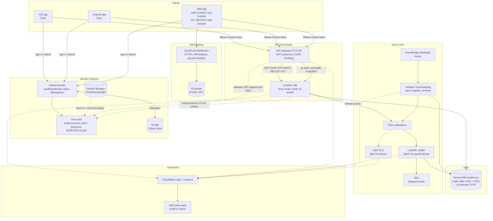
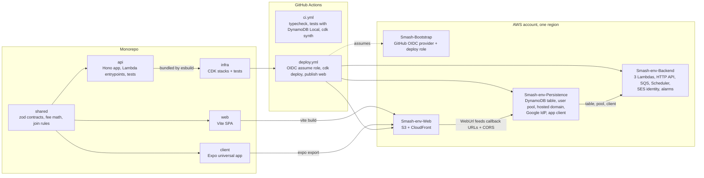
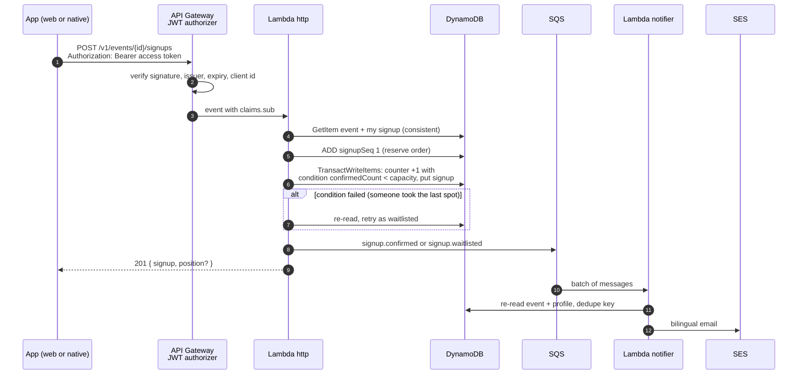

# BadmintonSmash — Architecture Diagrams

For review. Diagrams are Mermaid; GitHub and the VS Code Markdown preview render them. Companion to [02-system-design.md](02-system-design.md). Live dev values (account 242803616154, us-west-2) are shown as examples where useful; they are not secrets.

## 1. Runtime architecture



## 2. Deployment layout



Stack order is Web, then Persistence, then Backend. Context flags carry environment-specific settings; the dev environment is deployed with:

```
-c env=dev -c cognitoDomainPrefix=badmintonsmash-dev-6154 -c senderEmail=<verified SES address>
-c alarmEmail=<owner> -c cognitoSesEmail=true -c googleSecretName=smash/dev/google
```

The same flags must be passed on every deploy of that environment; dropping one removes the corresponding resource.

## 3. Request lifecycle: a player joins an event



## 4. Data model at a glance

```mermaid
erDiagram
  USER {
    string PK "USER#userId"
    string SK "PROFILE"
    string email
    string displayName
    string locale "en or zh-CN"
    json paymentHandles "etransfer, wechat, alipay, venmo, zelle, paypal, other"
  }
  EVENT {
    string PK "EVENT#eventId"
    string SK "META"
    string GSI1PK "HOST#hostId"
    string GSI1SK "startsAt#eventId"
    string GSI2PK "STATUS#status"
    string GSI2SK "visibility#startsAt#eventId"
    int capacity
    int confirmedCount
    int waitlistCount
    int signupSeq
    json venue "name, address, mapUrl, placeId, lat, lng"
    json fee "fixed or settle_after"
    json settlement "inputs, totals, per-player amounts"
  }
  SIGNUP {
    string PK "EVENT#eventId"
    string SK "SIGNUP#userId"
    string GSI1PK "USER#userId"
    string GSI1SK "startsAt#eventId"
    string status "confirmed, waitlisted, cancelled, removed"
    int seq "waitlist order"
    bool attended
    int amountOwedCents
    string paymentStatus "unpaid, paid, waived"
  }
  USER ||--o{ EVENT : hosts
  USER ||--o{ SIGNUP : has
  EVENT ||--o{ SIGNUP : contains
```

One table, two global secondary indexes. GSI1 answers "what does this user host or attend"; GSI2 answers "which events are open or need housekeeping".
