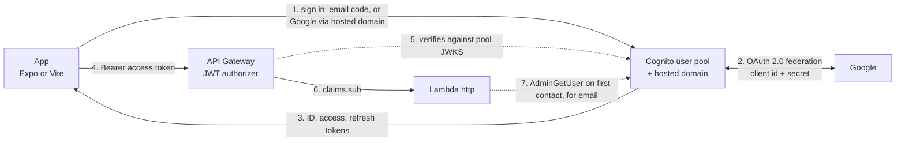
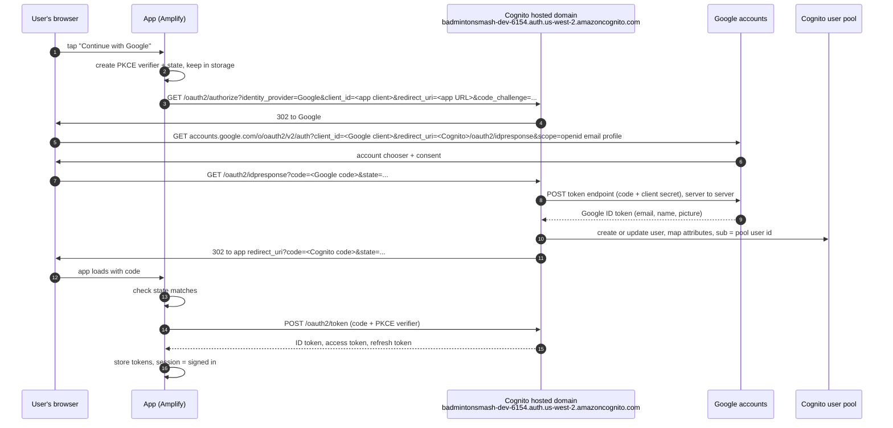
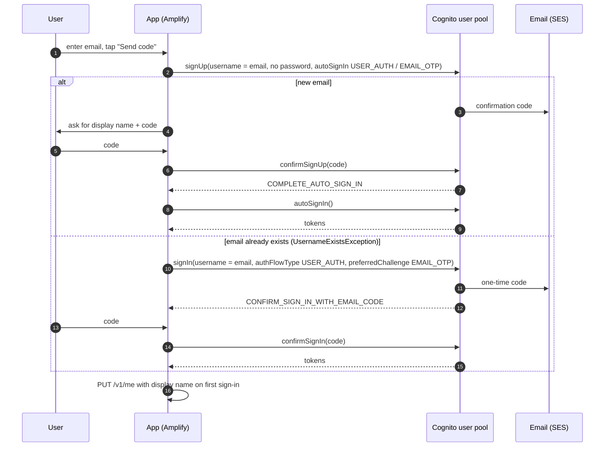
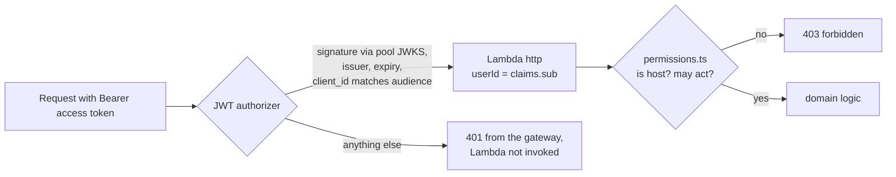

# BadmintonSmash — Authentication Flows

For review. Cognito is the only identity provider the app and the API trust; Google is federated through it, and email one-time code is Cognito-native. Companion to [02-system-design.md](02-system-design.md) section 9.

## 1. Who trusts whom

The API never sees a Google token and never handles a password or a code. It only ever receives a Cognito access token that the gateway has already validated.

## 2. Google sign-in (web)

### Redirect URIs, and why there are two

| Who redirects | Must be allowed where | Value (dev) |
|---|---|---|
| Google sends the browser back to Cognito | Google Cloud Console, OAuth client "Authorized redirect URIs" | `https://badmintonsmash-dev-6154.auth.us-west-2.amazoncognito.com/oauth2/idpresponse` |
| Cognito sends the browser back to the app | Cognito app client callback URLs (set by the Persistence stack) | `https://dugt1bg3jfc3u.cloudfront.net`, `http://localhost:8081`, `http://localhost:5173`, `badmintonsmash://` |

A `redirect_uri_mismatch` from Google means the first row is missing or different in Google Cloud Console. A Cognito error page about the redirect means the second row does not contain the app's URL.

### Where the secret lives

The Google client secret is used once per sign-in, by Cognito, in step 8. It is stored in Secrets Manager (`smash/<env>/google`) and injected into the Google identity provider at deploy time. The browser, the Lambda, and the repo never hold it.

## 3. Email one-time code (passwordless)

Prerequisites in the pool: ESSENTIALS feature plan, `EMAIL_OTP` allowed as a first factor, app client with `ALLOW_USER_AUTH`. Codes are sent through SES when `cognitoSesEmail=true`; while the SES account is in the sandbox only verified addresses receive them.

## 4. Tokens and the API

| Token | Lifetime | Used for |
|---|---|---|
| Access token | 60 min | `Authorization: Bearer` on every API call; carries `sub`, `client_id`, scopes |
| ID token | 60 min | Client-side display of email and name only |
| Refresh token | 30 days | Silent renewal of the other two by Amplify |

Routes without a token: `GET /v1/health` and `GET /v1/public/*` (redacted event views). Authenticated routes are registered with explicit methods, never `ANY`, so the browser's OPTIONS preflight is answered by the gateway's CORS handler instead of the authorizer.

Local development bypass: with `DEV_AUTH=1` on the API and `EXPO_PUBLIC_DEV_AUTH=1` or `VITE_DEV_AUTH=1` on a client, the header `x-dev-user: <id>` stands in for a token and unknown ids get a synthetic `<id>@dev.local` profile. The flag is never set in AWS.

## 5. Constraints to keep in mind

- **WeChat in-app browser**: Google refuses to show its sign-in page inside embedded webviews (`disallowed_useragent`). The app detects `MicroMessenger` in the user agent, hides the Google button and shows "open in Safari or Chrome"; the email code flow works there.
- **Native apps**: Google sign-in on iOS and Android needs a system-browser bridge for Amplify (`@aws-amplify/rtn-web-browser`), not yet added; email code works natively today.
- **Apple**: once Google ships in the iOS store build, App Store guideline 4.8 requires Sign in with Apple as well (P1).
- **WeChat login** (P1): WeChat OAuth is not OIDC, so it is bridged by a small OIDC shim that Cognito trusts as a generic provider; see the system design, section 9.2. It needs a verified WeChat Open Platform account first.
- **Account deletion**: `DELETE /v1/me` anonymises signups, cancels upcoming hosted events, deletes the profile, then removes the Cognito user.
